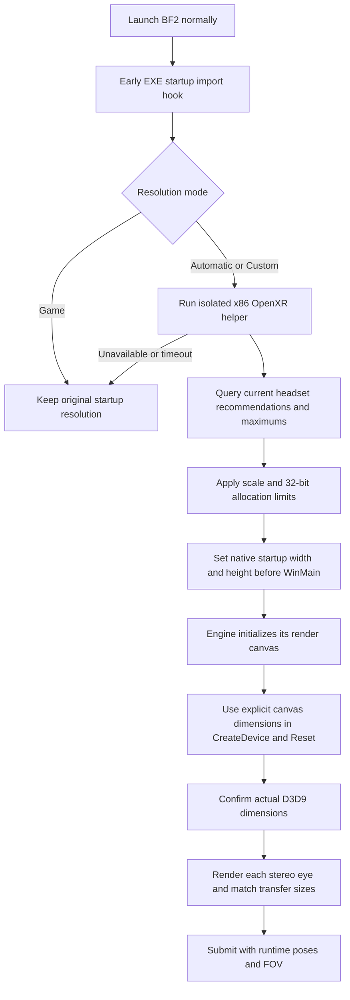

# Automatic headset resolution: BF2-VR implementation reference

For **justiceofrip / BF2142VR** and the Codex working on that port. This separate reference area was published at the BF2-VR maintainer's request on 1 October 2026.

**The fix was to resize the game's actual render canvas before engine initialization, then keep the game render targets and OpenXR submission consistent.** A larger OpenXR swapchain alone only upscales the existing game image.

This folder contains the resolution implementation from the BF2-VR private development line, plus its integration points. It is developer reference material, not an installer or a new gameplay release. The existing public `src/`, `payload/`, releases and guides are separate from this reference snapshot.

## Start here

1. Read [the integration guide](INTEGRATION.md).
2. Inspect [AutoResolution.cpp](reference/RFX/AutoResolution.cpp): the BF2 startup hook and bounded headset query.
3. Inspect [VrResolution.cs](reference/tools/VrResolution.cs) and [VrResolutionPlan.cs](reference/tools/VrResolutionPlan.cs): querying the current runtime and selecting a render size.
4. Inspect [RenderWindow.cpp](reference/RFX/RenderWindow.cpp): keeping the monitor window separate from the render canvas, including `WM_SIZE`, mouse coordinates, `CreateDevice` and `Reset`.
5. Read [the OpenXR/render integration excerpts](reference/integration/RuntimeSizing.excerpts.cpp) and [porting/verification notes](PORTING.md).

These are BF2-specific source references. They have not been integrated into or tested with BF2142. Adapt the engine startup and renderer integration to BF2142's own code and loader.

## What was actually wrong

There are several different sizes in this pipeline:

| Size | Role |
| --- | --- |
| Runtime recommendation per eye | Desired image size reported by the connected OpenXR runtime |
| BF2 render canvas / D3D9 backbuffer | Resolution at which the native engine prepares its frame; our stereo replay renders each eye at this size |
| Eye capture / transfer image | Resolution of the pixels copied from the game into the VR transport |
| OpenXR swapchain and submitted rectangle | Container and rectangle used by the compositor |
| Desktop client window | Monitor preview size; it can be smaller than the render canvas |

BF2 could render at its ordinary video resolution while the OpenXR side allocated a larger image. Copying that low-resolution frame into a larger texture did not create more scene detail. The fix had to reach the native game renderer.

## Pipeline used in BF2



### 1. Ask the runtime, every launch

The x86 helper creates an OpenXR instance, gets the HMD system and enumerates `XR_VIEW_CONFIGURATION_TYPE_PRIMARY_STEREO`. It reads both eyes' `recommendedImageRectWidth/Height` and `maxImageRectWidth/Height`. These are the runtime's render recommendations and limits. They are not a lookup of the physical display panel's pixels. See the [Khronos view configuration definition](https://registry.khronos.org/OpenXR/specs/1.1/man/html/XrViewConfigurationView.html) and [enumeration API](https://registry.khronos.org/OpenXR/specs/1.1/man/html/xrEnumerateViewConfigurationViews.html).

BF2 uses one common native canvas, so the helper takes the larger recommended width/height across the two eyes, then respects the smaller maximum width/height supported by the two eyes. A port with genuinely independent eye render targets can use each eye's recommendation directly.

The helper uses the same installed **32-bit OpenXR loader** as BF2. It creates no XR session or graphics device. It exits before the game's full OpenXR initialization. Do not reuse a size cached from a previous headset or runtime connection.

### 2. Select the size explicitly

```ini
[graphics]
; 0 = Automatic, 1 = Custom percentage, 2 = Game
resolution_mode=0
eye_resolution_percent=100
```

Automatic uses 100% of the current recommendation. Custom applies a **linear** percentage to each dimension; 150% therefore requests approximately 2.25 times as many pixels. Game keeps the original BF2 startup options. Changes require restarting BF2.

The current BF2 policy bounds each dimension to 4096 and the area to 8,388,608 pixels per eye, in addition to the runtime maximums. If needed, it scales both dimensions down together to retain their aspect. Those are this implementation's conservative 32-bit allocation limits, not universal OpenXR limits. The helper reports when a limit was applied. See [VrResolutionPlan.cs](reference/tools/VrResolutionPlan.cs).

### 3. Let BF2 initialize its native renderer at that size

For the supported BF2 1.5 startup, the DLL is loaded before the EXE entry point. The implementation hooks the EXE's imported `__getmainargs`; after the original function returns, it performs the headset query and redirects **the EXE's `_acmdln` data import** to a process-lifetime replacement string. Inspection of this BF2 executable established that its WinMain startup reads that import after `__getmainargs`.

It replaces only these startup options:

```text
+fullscreen 0 +szx <requested-eye-width> +szy <requested-eye-height>
```

The native engine then creates its own dependent render targets at the requested size. It does not require a special Launch VR button. Existing quoted mod/profile/account arguments are preserved; the full command line is not logged. The shared CRT command-line storage, process PEB, and BF2.exe file are not rewritten by this resolution feature.

**The startup ordering is specific to the inspected BF2 executable.** Before using this mechanism in BF2142, inspect where its loader runs and where its engine reads video dimensions. An external launcher that queries the runtime before starting the game can also use native launch options, provided it preserves the normal Steam/authentication and launch path.

`DllMain` installs only the import hook. The helper process and OpenXR query run later, outside loader lock. Microsoft documents the restrictions on loading DLLs and creating processes inside `DllMain` in [DLL best practices](https://learn.microsoft.com/en-us/windows/win32/dlls/dynamic-link-library-best-practices).

### 4. Separate the preview window from the render canvas

Simply shrinking the huge headset-sized desktop window caused a second problem: BF2's native `WM_SIZE` handler could replace the render dimensions with the smaller window size. A windowed D3D9 backbuffer requested with zero dimensions could also inherit that small client size.

[RenderWindow.cpp](reference/RFX/RenderWindow.cpp) addresses the combination:

- Fit the actual desktop window to the monitor independently of the eye canvas.
- Forward the logical render width/height to BF2 for non-minimized `WM_SIZE` events.
- Preserve minimized events for native focus/device-loss handling.
- Explicitly set D3D9 backbuffer width/height on **both `CreateDevice` and `Reset`**.
- Map desktop client mouse coordinates into the larger logical canvas.
- Apply this only to the main game window after a successful Automatic/Custom request.

This is not a recommendation to resize only D3D9 surfaces after the engine has already allocated its resources. Startup dimensions, native screen bookkeeping, color/depth targets, viewport and capture dimensions must agree. Menus and HUD layout remain an additional engine/UI concern.

### 5. Confirm the source, then match the transfer

After device creation/reset, query the actual backbuffer `D3DSURFACE_DESC` and compare it with the request. At stereo capture time, also confirm the source surface size. A successful size query or big swapchain is insufficient evidence by itself.

The BF2 OpenXR integration retains each runtime view's recommendation and maximums. When automatic sizing was requested, it can match the transfer to the actual native render size within those maximums. In legacy Game mode it can retain a smaller source-sized transfer to avoid useless upscaling. It allocates both replacement eye chains before replacing the working pair; see [RuntimeSizing.excerpts.cpp](reference/integration/RuntimeSizing.excerpts.cpp).

Keep the original OpenXR per-eye FOV, view poses and IPD. A texture's pixel aspect is not a substitute for the runtime projection. Desktop mirror crop/fit must be handled independently.

## Fallback and evidence

- Missing helper, unavailable headset/runtime, invalid response or a query lasting more than 15 seconds: continue with game resolution and report the fallback.
- Startup hook unavailable: report the actual game size; do not label automatic resolution active.
- Actual render size differs from request: record a mismatch rather than claiming success.
- Safety limit applied: report the limited dimensions rather than claiming full recommendation.
- Resolution preference changes: save the preference without reinstalling the mod. The separate [ResolutionChoice.cs](reference/installer/ResolutionChoice.cs) shows r63's staged save and distinct settings backup; it depends on the repository's `PeImage.Hash` helper.

The reference writes recommendation, requested size, actual native size and transfer size to `bf2_vr_resolution.ini`, plus `RESOLUTION49` / `RESOLUTION60` messages in the game log. Those numbers are diagnostics, not future startup inputs. See the [porting guide](PORTING.md) for a proposed verification sequence and illustrative log.

## Scope and provenance

The BF2 maintainer reported that the resulting headset image was crisp. That report does not establish BF2142 compatibility, a performance increase, every-headset support, or completion of unrelated UI work. Higher scene resolution increases rendering cost. The ongoing r63 crash-camera trial is not part of this reference.

See [PROVENANCE.md](PROVENANCE.md) for the exact snapshot scope, hashes, dependencies and existing license notices. This directory contains source/text only, with no game binaries, assets, personal profiles, recordings or captured user logs.
